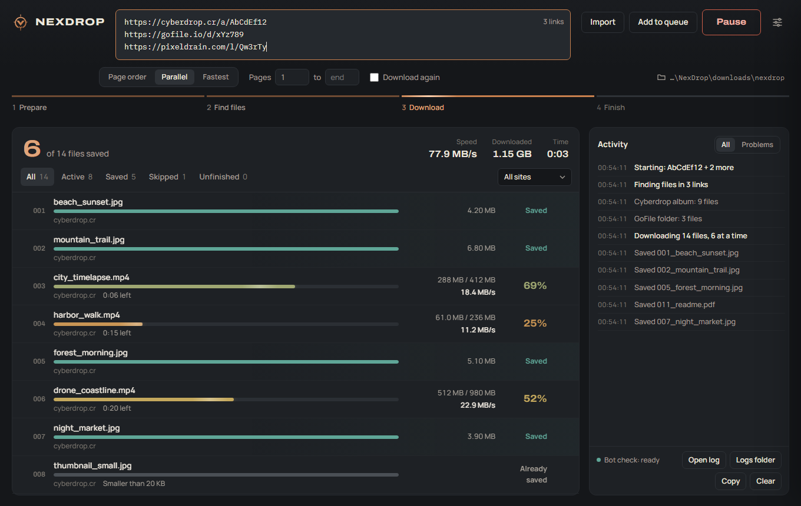
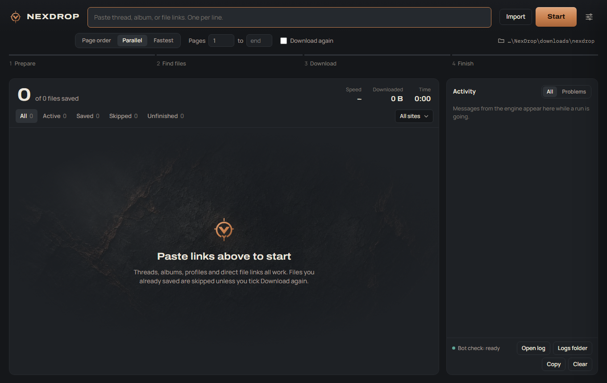

# NEXDROP

One interface. Multiple sources. Real-time control.

NEXDROP is a portable download manager for Windows x64. Paste links to forum threads, albums, profiles,
file-host folders or single files and it saves every file in page order, with live progress for each one.
It runs on a patched copy of the [Cyberdrop-DL](https://github.com/Cyberdrop-DL/cyberdrop-dl) 10.10.0
engine, which supports 226 sites, and adds its own Electron window, queue, pause and resume, watched
threads, sign-ins and Telegram account downloads.



<sub>The screenshot shows the NEXDROP window with example links and file names.</sub>

## Download

Download `NexDrop-windows-x64.zip` from the latest [release](https://github.com/Saiki1997/NexDrop/releases)
and check it against the SHA-256 checksum published with it (`SHA256SUMS.txt`). Extract the whole folder
and run `NexDrop.exe`. Nothing else needs installing: Python, ffmpeg and FlareSolverr are bundled.

NEXDROP 2.4.0 and later check GitHub for a new release and update themselves: press **Update now** on the
banner. The zip is checked against the release's SHA-256 checksum before anything is replaced. To update
by hand (or from 2.3.4 and earlier), close NEXDROP and extract the new zip over the folder. Settings,
sign-ins, history and downloads in `engine\appdata` and `downloads` are kept either way.

### System requirements

- 64-bit Windows 10 or Windows 11
- About 1.5 GB of disk space for the app, plus room for your downloads

## What it does

- Paste thread, album, profile or file links (one per line) and press **Start**. Files are saved in
  page order (`001_`, `002_`…), many at a time. Choose **Page order**, **Parallel** or **Fastest**, and
  limit forum threads to a range of pages.
- Every file has its own progress bar with size, percentage, speed in MB/s and time left. Filter the list
  by Active, Saved, Skipped or Unfinished, or by site.
- **Queue** more links while a run is going. **Pause** keeps a run; **Resume** continues it, even after
  closing NEXDROP or a crash, and half-downloaded files continue where they stopped.
- **Watch** forum threads, albums, profiles, channels and playlists: NEXDROP rechecks them every 30
  minutes to a week while it is open and downloads only new files.
- **Several jobs at once**, large files in parts, per-site limits, and big link lists run in parts of 200.
- **Download rules** skip files, keep only some, or send them to a folder by site, type, size, name or
  creator. **Check** a list of links before downloading, and **preview the names** files will get.
- **Library**: everything you downloaded, with a gallery, search, duplicates and similar files, storage
  use, organize and rename with undo, archive checks and statistics.
- **When a job finishes**: notify, open the folder, organize, verify the files and save a manifest with
  every file's SHA-256.
- Bot-check pages (DDoS-Guard, Cloudflare) are solved by the bundled FlareSolverr, which starts in the
  background.
- Temporary server errors (500, 502, 503, 504, 429, timeouts) are retried automatically. Files you
  already saved are skipped unless you tick **Download again**.
- Filter by file type (Images, Videos, Audio, Other) or minimum image size, and optionally sort new files
  into type folders.
- **Telegram**: public channels and posts download without an account. Sign in with your Telegram
  account (your own API ID from my.telegram.org) for large files, documents and private channels or
  groups you've joined. NEXDROP only reads and downloads; it never posts, joins or leaves anything.
- **Sign-ins**: API tokens, a MEGA account, a Telegram account or per-site cookie files. Secrets are
  encrypted with Windows credential protection and never shown again.
- **History**: search every file from earlier runs by name, link or site, show it in its folder or add
  its link again.
- **Download hours and quiet hours**: start queued links and watched-thread checks only at night, or use a
  lower speed cap in the evening. An optional **proxy** applies to every download.
- **Tray and start with Windows**: closing the window can keep NEXDROP running in the tray, so watched
  threads keep being checked.
- **Copied links and the browser**: optionally add links you copy to the links box, or right-click in
  Chrome, Edge or Brave with the bundled extension (`browser-extension`) to send pages and links.
- Checks for new versions and updates itself (Settings → App).
- Taskbar progress and a Windows notification when a run finishes.
- Every run writes a readable log to `engine\appdata\logs\runs`; press **Open log** in the Activity panel.



## Supported sites

The bundled engine has crawlers for **226 sites**. The full list, with every domain and the kinds of
links each one accepts, is in **[docs/SUPPORTED-SITES.md](docs/SUPPORTED-SITES.md)**. A selection:

| Kind | Sites |
| --- | --- |
| File hosts | 1fichier, Bunkr, BuzzHeavier, Catbox, Cyberdrop, Cyberfile, DoodStream, Fileditch, GoFile, Iceyfile, Mediafire, MEGA, MixDrop, PixelDrain, SendVid, Streamtape, Upload.ee, Voe.sx, WeTransfer |
| Cloud storage | Box, cloud.mail.ru, Dropbox, Google Drive, Google Photos, Koofr, OneDrive, ownCloud, pCloud, Yandex Disk |
| Forums | SimpCity, Bellazon, CelebForum, F95Zone, SocialMediaGirls, ViperGirls, XBunker, Discourse forums, 4chan |
| Image hosts | ImageBam, ImageVenue, ImgBB, ImgBox, Imgur, Imx.to, PixHost, PostImg, Vipr.im |
| Social and video | BlueSky, Dailymotion, Erome, Kick, Odysee, ok.ru, Patreon, PeerTube, Pinterest, Reddit, RedGifs, Rumble, Rutube, Streamable, Telegram, TikTok, Twitch, Twitter / X, Vimeo, VSCO |
| Music and other | Archive.org, Bandcamp, Monstercat, Soundgasm, Real-Debrid, direct file links |

Being listed means the site is registered in this build. Sites change their pages often, and not every
site has been tested live; if one fails, please open an [issue](https://github.com/Saiki1997/NexDrop/issues)
with the run log (remove anything private first).

## How it is built

`NexDrop.exe` is Electron 42. It opens the window from `resources\app` and starts the bundled Python 3.13
(`runtime\python`) to run `desktop\cairn_session.py`, which drives the patched Cyberdrop-DL 10.10.0
engine through `engine\bridge.py`. ffmpeg (`runtime\ffmpeg`) handles HLS video and FlareSolverr
(`runtime\flaresolverr`) handles bot checks. Settings, history and logs stay in `engine\appdata`; files
are saved to `downloads\nexdrop` unless you choose another folder.

NEXDROP has no hosted website, remote API or cloud database. It only connects to the sites you download
from. Telegram account downloads use Telethon (MIT), shipped in `engine\thirdparty`.

## Troubleshooting

- Keep `NexDrop.exe` beside `resources`, `desktop`, `engine` and `runtime`. A short folder path avoids the
  Windows 260-character limit.
- `NexDrop.exe` is not code-signed. If SmartScreen warns, choose **More info**, then **Run anyway**. If
  antivirus quarantines a runtime file, restore it.
- For a failed run, press **Open log** in the Activity panel. The run log and the engine's detailed log
  are in `engine\appdata\logs\runs`; FlareSolverr's output is in `engine\appdata\logs\flaresolverr.log`.

## Source code

This repository holds the full source of the Windows build:

| Folder | What it is |
| --- | --- |
| `electron/` | The NEXDROP window: main process, preload bridge, and the page in `renderer/` |
| `desktop/` | Python that runs one download session, sign-in cookies, job history, the site registry |
| `engine/bridge.py` | Adapter between NEXDROP and the bundled engine |
| `engine/vendor/` | Patched Cyberdrop-DL 10.10.0 (GPL-3.0), with the fixes from `engine/vendor-patches/` applied |
| `windows/` | `build-electron-portable.sh`, `make-release.sh`, `telegram-libs.sh` (pinned Telethon for `engine\thirdparty`) and the pinned Python requirements |
| `browser-extension/` | "Send to NEXDROP" extension for Chromium browsers (load unpacked) |
| `tools/` | `engine-upstream-report.py`: read-only comparison of the bundled engine with a newer Cyberdrop-DL |
| `tests/` | Python and Node tests, run on Windows by GitHub Actions on every push |
| `docs/` | Supported sites, release notes, screenshots |

What changed in each version is in [`CHANGELOG.md`](CHANGELOG.md).

### Running the tests

```
python -m pip install -r windows/requirements-win.txt pyflakes
python -m pyflakes desktop engine/bridge.py
python -m unittest discover -s tests -p "test_*.py"
node --test tests/format.test.js
```

Engine tests need `PYTHONPATH=engine/vendor` and `CDL_APPDATA_FOLDER` set to a temporary folder, as in
`.github/workflows/ci.yml`.

### Building the portable folder

`windows/build-electron-portable.sh` downloads Electron 42.2.0 for Windows and assembles the portable
folder. It expects the embeddable Python, ffmpeg and FlareSolverr in `release/NexDrop/runtime/` (they are
too large for this repository; take them from a release zip).

### Publishing a release

1. Set the new version in `electron/package.json`, add `docs/release-notes/<version>.md` and update
   `CHANGELOG.md`.
2. On GitHub, open **Actions > Release > Run workflow**.

The workflow takes Electron, Python, ffmpeg and FlareSolverr from an earlier release zip, adds this
repository's files with `windows/make-release.sh`, and publishes `NexDrop-windows-x64.zip`,
`NexDrop-source.zip` and `SHA256SUMS.txt` as release `v<version>`.

## Credits

- **[Cyberdrop-DL](https://github.com/Cyberdrop-DL/cyberdrop-dl)** by Jacob B (jbsparrow) and its
  contributors is the download engine behind NEXDROP: the site crawlers, the downloader and most of
  what makes 226 sites work. NEXDROP ships version 10.10.0 (`cyberdrop-dl-patched`) with local fixes,
  each listed in [`engine/vendor-patches/README.md`](engine/vendor-patches/README.md). Problems with
  NEXDROP's patched copy belong in this repository's issues, not upstream. If the engine helps you,
  consider [supporting its author](https://github.com/sponsors/jbsparrow).
- [FlareSolverr](https://github.com/FlareSolverr/FlareSolverr) solves bot-check pages.
- [Telethon](https://github.com/LonamiWebs/Telethon) (MIT) handles Telegram account downloads.
- [ffmpeg](https://ffmpeg.org) joins HLS video streams.
- [Electron](https://www.electronjs.org) runs the window.
- The interface started from Cairn (MIT); the Archivo and Manrope fonts are under the SIL Open Font
  License.

## Licensing

NEXDROP includes Cyberdrop-DL (GPL-3.0-only); its patched source is in `engine/vendor`, and this
repository is licensed under GPL-3.0 (`LICENSE`). The interface started from Cairn (MIT,
`electron/LICENSE-CAIRN.txt`). The Archivo and Manrope fonts are under the SIL Open Font License
(`electron/renderer/fonts`). Each release also has `NexDrop-source.zip`, the source it was built from.

Download only content you have the right to download, and follow the terms of the sites you use.

## Issues

Please report reproducible errors, startup failures, and compatibility issues through the repository's
[Issues](https://github.com/Saiki1997/NexDrop/issues) section. Do not include passwords, authentication
cookies, or private account information.
